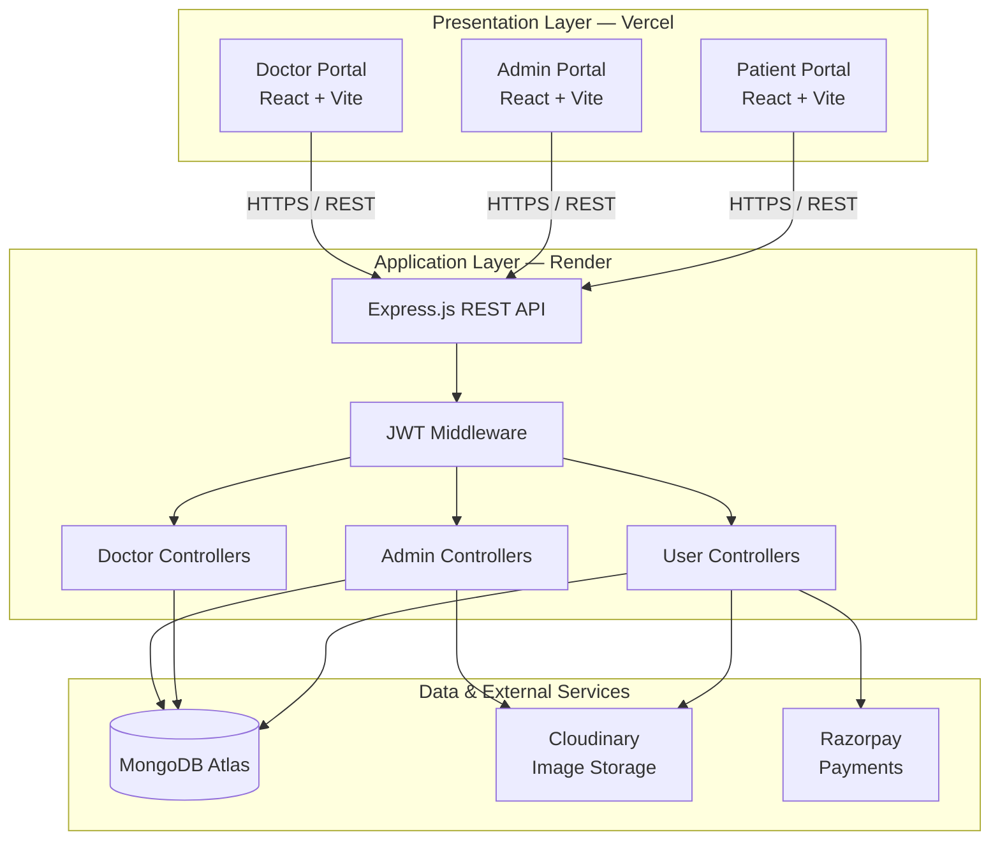
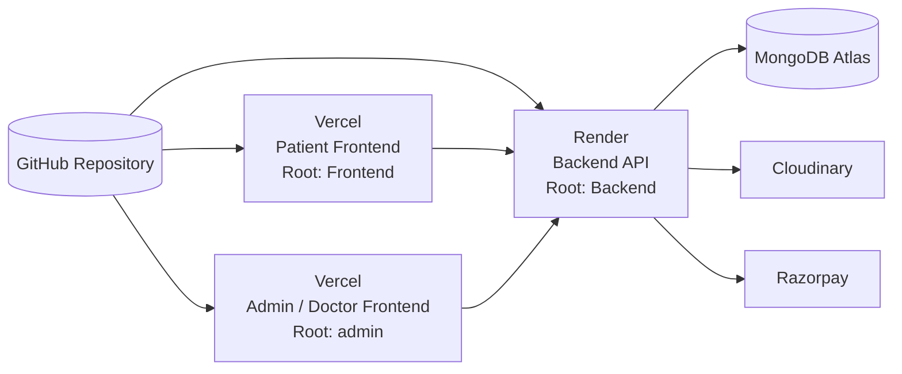
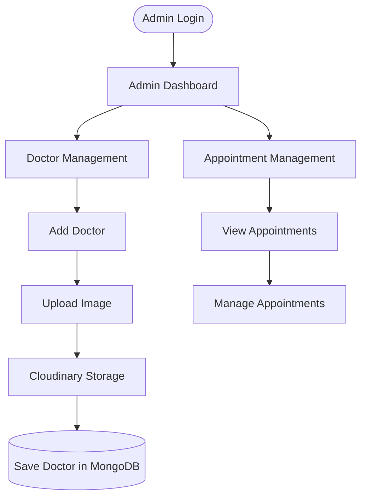
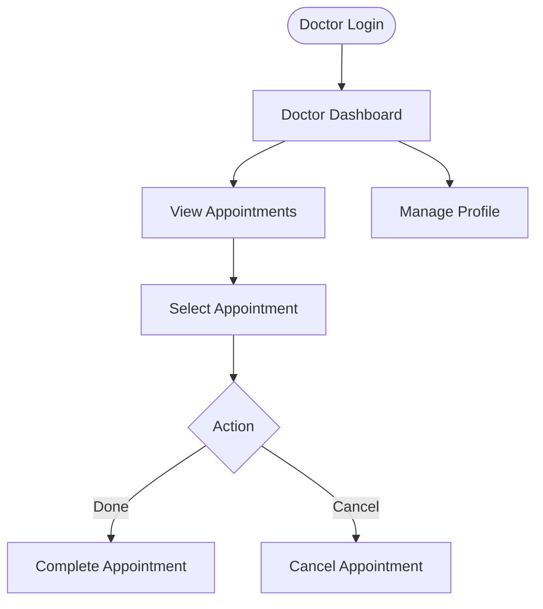
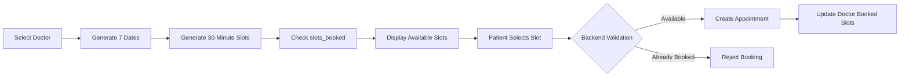
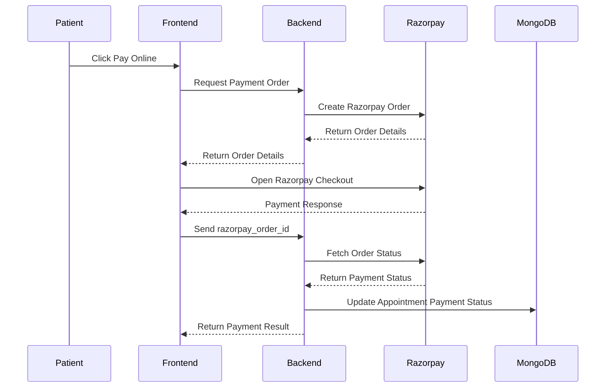
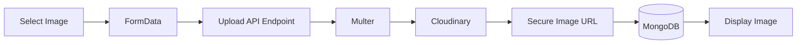
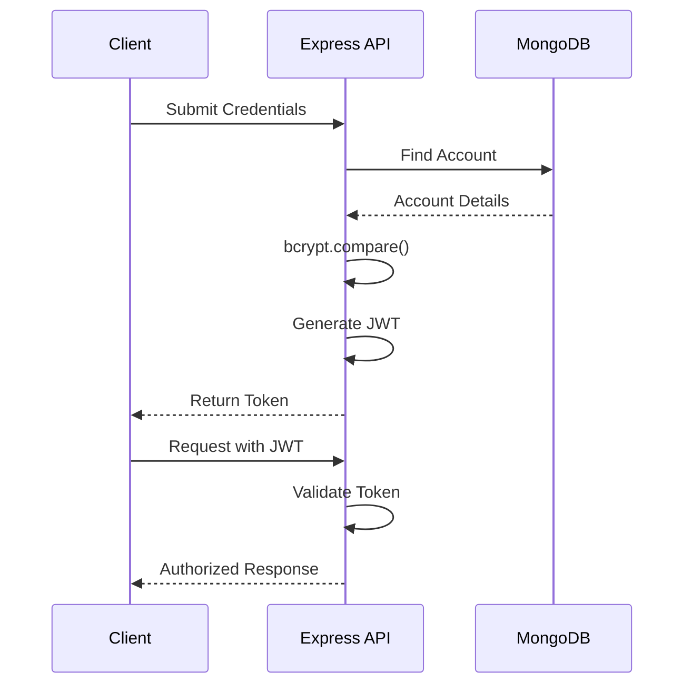
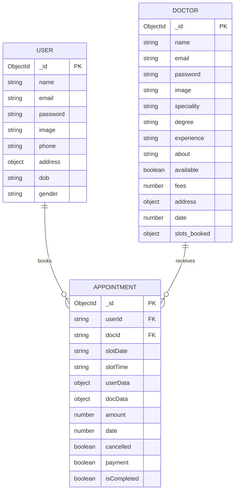

# Prescripto — Doctor Appointment & Healthcare Management Platform

A full-stack healthcare platform that connects **patients, doctors, and administrators** through a centralized appointment-management system.

Prescripto allows patients to discover doctors, book appointments, make online payments, and manage their bookings. Doctors can manage their schedules, while administrators can manage doctors and appointments.

**Built with React, Node.js, Express, MongoDB, and Razorpay.**

---

## Table of Contents

- [Architecture & Live Deployments](#architecture--live-deployments)
- [Features](#features)
- [User Journeys](#user-journeys)
- [Appointment Scheduling](#appointment-scheduling-engine)
- [Payment Integration](#payment-integration)
- [File Uploads](#file-uploads)
- [Authentication & Security](#authentication--security)
- [Database Design](#database-design)
- [API Reference](#api-reference)
- [Tech Stack](#tech-stack)
- [Project Structure](#project-structure)
- [Getting Started](#getting-started)
- [Production Deployment](#production-deployment)
- [Engineering Decisions](#engineering-decisions)
- [Roadmap](#roadmap)
- [What I Learned](#what-i-learned)

---

## Architecture & Live Deployments

Prescripto follows a three-tier architecture consisting of independent React frontends, a centralized Express REST API, and external services for database storage, image management, and payments.

### Live Applications

| Application | Description | Deployment |
|---|---|---|
| Patient Portal | Browse doctors, book appointments, make payments, and manage bookings | [Open Patient Portal](https://prescripto-nu-three.vercel.app/) |
| Admin / Doctor Portal | Manage doctors, appointments, availability, and doctor profiles | [Open Admin / Doctor Portal](https://prescripto-admin-navy.vercel.app/login) |
| Backend REST API | Centralized Express API serving both frontend applications | [Backend API](https://prescripto-backend-o7lj.onrender.com) |
| Source Code | Complete project repository | [GitHub Repository](https://github.com/aryankk073/Prescripto) |

### System Architecture



### Deployment Architecture

The project is deployed using three independent services connected through a shared backend.



| Component | Platform | Root Directory |
|---|---|---|
| Patient Frontend | Vercel | `Frontend` |
| Admin / Doctor Frontend | Vercel | `admin` |
| Backend API | Render | `Backend` |
| Database | MongoDB Atlas | Managed |
| Image Storage | Cloudinary | Managed |
| Payment Gateway | Razorpay | Managed |

### Technology Responsibilities

| Layer | Technology | Responsibility |
|---|---|---|
| Patient Frontend | React, Vite, Tailwind CSS | Patient-facing interface |
| Admin / Doctor Frontend | React, Vite, Tailwind CSS | Administrative and doctor interfaces |
| Routing | React Router | Client-side navigation |
| State Management | React Context API | Shared application state |
| HTTP Requests | Axios | Frontend-backend communication |
| Backend | Node.js, Express.js | Business logic and REST APIs |
| Database | MongoDB Atlas, Mongoose | Persistent data storage |
| Authentication | JWT, bcrypt | Authentication and password security |
| File Storage | Multer, Cloudinary | Image upload and storage |
| Payments | Razorpay | Online payment processing |
| Hosting | Vercel, Render | Production deployment |

---

## Features

### Patient Portal

- Browse doctors and filter by speciality.
- View detailed doctor profiles.
- Explore related doctors.
- Select appointment dates and available time slots.
- Book appointments.
- View and cancel appointments.
- Make online payments using Razorpay.
- Update personal profile information.
- Upload profile images.

### Doctor Portal

- Dedicated doctor login.
- View personal dashboard.
- View assigned appointments.
- Complete appointments.
- Cancel appointments.
- View and update personal profile.

### Admin Portal

- Secure administrator login.
- View administrative dashboard.
- Add doctors with image uploads.
- Browse the doctor directory.
- Change doctor availability.
- View all appointments.
- Cancel appointments.

### Project Highlights

| Feature | Implementation |
|---|---|
| Role-based experiences | Separate patient, doctor, and admin interfaces |
| Authentication | JWT-based authentication |
| Password security | bcrypt password hashing |
| Appointment scheduling | Seven-day scheduling window with 30-minute slots |
| Payment integration | Razorpay order creation and payment status verification |
| Image uploads | Multer and Cloudinary |
| Centralized backend | One Express API serving both frontend applications |
| Deployment | Two Vercel frontends and one Render backend |

---

## User Journeys

### Patient Booking Journey


### Admin Workflow



### Doctor Workflow



---

## Appointment Scheduling Engine

Appointment scheduling is one of the core features of Prescripto.

The patient application dynamically generates available appointment slots based on the selected doctor and date.

| Parameter | Value |
|---|---|
| Scheduling Window | 7 days |
| Slot Duration | 30 minutes |
| Start Time | 10:00 AM |
| End Time | 9:00 PM |
| Availability | Based on existing bookings and doctor availability |

### Scheduling Workflow



The frontend generates available slots, but the backend is responsible for validating the booking before creating an appointment.

A future improvement would be implementing atomic booking operations to prevent conflicts when multiple patients attempt to book the same slot simultaneously.

---

## Payment Integration

Prescripto integrates Razorpay to support online appointment payments.

The payment workflow involves the frontend, backend, Razorpay, and MongoDB.

### Payment Workflow



### Important Implementation Details

- Payment orders are created through the backend.
- Razorpay Checkout is opened from the frontend.
- The backend fetches the order status directly from Razorpay.
- An appointment is marked as paid when the fetched order status is `paid`.

The backend does not rely solely on a client-side success response to mark an appointment as paid.

---

## File Uploads

Prescripto uses Multer and Cloudinary to handle image uploads.

### Upload Workflow



### Implementation

1. The frontend sends image data using `FormData`.
2. Multer processes the uploaded file.
3. The backend uploads the image to Cloudinary.
4. Cloudinary returns a secure image URL.
5. The URL is stored in MongoDB.
6. The frontend uses the stored URL to display the image.

MongoDB stores the image URL rather than the actual image file.

---

## Authentication & Security

Prescripto uses JSON Web Tokens (JWT) for authentication and bcrypt for password hashing.

### Authentication Workflow



### Security Components

| Component | Responsibility |
|---|---|
| JWT | Token-based authentication |
| bcrypt | Password hashing and verification |
| Authentication Middleware | Protects user, doctor, and admin endpoints |
| Environment Variables | Keeps sensitive configuration out of source control |
| CORS | Allows deployed frontends to communicate with the backend |
| Role Separation | Separate authentication contexts for different user roles |

---

## Database Design

Prescripto uses MongoDB with Mongoose for database modelling.

Appointments reference both patients and doctors using their IDs. They also store snapshots of patient and doctor information to simplify appointment data retrieval.

### Entity Relationship Diagram



### Main Collections

**User**

- `name`
- `email`
- `password`
- `image`
- `phone`
- `address`
- `dob`
- `gender`

**Doctor**

- `name`
- `email`
- `password`
- `image`
- `speciality`
- `degree`
- `experience`
- `about`
- `available`
- `fees`
- `address`
- `date`
- `slots_booked`

**Appointment**

- `userId`
- `docId`
- `slotDate`
- `slotTime`
- `userData`
- `docData`
- `amount`
- `date`
- `cancelled`
- `payment`
- `isCompleted`

The model files inside `Backend/models` are the source of truth for the exact schema definitions.

---

## API Reference

### Base URL

```text
https://prescripto-backend-o7lj.onrender.com
```

### Route Groups

| Route Group | Base Path | Responsibility |
|---|---|---|
| User | `/api/user` | Registration, login, profiles, appointments and payments |
| Doctor | `/api/doctor` | Doctor listing, login, appointments and profile |
| Admin | `/api/admin` | Admin login and administrative operations |

### User Endpoints

Protected endpoints require a valid JWT.

| Endpoint | Method | Authentication | Purpose |
|---|---|---|---|
| `/api/user/register` | POST | No | Register patient |
| `/api/user/login` | POST | No | Patient login |
| `/api/user/get-profile` | GET | Yes | Retrieve patient profile |
| `/api/user/update-profile` | POST | Yes | Update patient profile |
| `/api/user/book-appointment` | POST | Yes | Book appointment |
| `/api/user/appointments` | GET | Yes | List patient appointments |
| `/api/user/cancel-appointment` | POST | Yes | Cancel appointment |
| `/api/user/payment-razorpay` | POST | Yes | Create Razorpay order |
| `/api/user/verifyRazorpay` | POST | Yes | Verify payment status |

### Doctor Endpoints

| Endpoint | Method | Authentication | Purpose |
|---|---|---|---|
| `/api/doctor/list` | GET | No | Get doctor listing |
| `/api/doctor/login` | POST | No | Doctor login |
| `/api/doctor/appointments` | POST | Yes | Get doctor's appointments |
| `/api/doctor/complete-appointment` | POST | Yes | Complete appointment |
| `/api/doctor/cancel-appointment` | POST | Yes | Cancel appointment |
| `/api/doctor/dashboard` | GET | Yes | Get dashboard data |
| `/api/doctor/profile` | GET | Yes | Get doctor profile |
| `/api/doctor/update-profile` | POST | Yes | Update doctor profile |

### Admin Endpoints

| Endpoint | Method | Authentication | Purpose |
|---|---|---|---|
| `/api/admin/login` | POST | No | Admin login |
| `/api/admin/add-doctor` | POST | Yes | Add doctor |
| `/api/admin/all-doctors` | POST | Yes | Get all doctors |
| `/api/admin/change-availability` | POST | Yes | Change doctor availability |
| `/api/admin/all-appointments` | POST | Yes | Get all appointments |
| `/api/admin/cancel-appointment` | POST | Yes | Cancel appointment |
| `/api/admin/dashboard` | GET | Yes | Get dashboard data |

For exact implementation details, refer to `Backend/routes` and `Backend/controllers`.

### Testing the API

Check whether the backend is running:

```bash
curl https://prescripto-backend-o7lj.onrender.com
```

Expected response:

```text
API WORKING
```

Get the doctor listing:

```bash
curl https://prescripto-backend-o7lj.onrender.com/api/doctor/list
```

---

## Tech Stack

### Frontend

- React 19
- Vite
- React Router DOM
- Tailwind CSS
- Axios
- React Context API

### Backend

- Node.js
- Express.js
- MongoDB Atlas
- Mongoose
- JSON Web Tokens
- bcrypt
- Multer
- Validator
- CORS
- dotenv

### Integrations and Deployment

- Cloudinary — image storage
- Razorpay — payment processing
- Vercel — frontend hosting
- Render — backend hosting
- Git and GitHub — version control

---

## Frontend Routes

### Patient Application

| Route | Description |
|---|---|
| `/` | Homepage |
| `/doctors` | All doctors |
| `/doctors/:speciality` | Doctors by speciality |
| `/login` | Patient login and registration |
| `/about` | About page |
| `/contact` | Contact page |
| `/my-profile` | Patient profile |
| `/my-appointments` | Patient appointments |
| `/appointment/:docId` | Doctor appointment booking |

### Admin Application

| Route | Description |
|---|---|
| `/login` | Admin login |
| `/admin-dashboard` | Admin dashboard |
| `/all-appointments` | Appointment management |
| `/add-doctor` | Add doctor |
| `/doctor-list` | Doctor directory |

### Doctor Application

| Route | Description |
|---|---|
| `/login` | Doctor login |
| `/doctor-dashboard` | Doctor dashboard |
| `/doctor-appointments` | Doctor appointments |
| `/doctor-profile` | Doctor profile |

---

## Project Structure

```text
Prescripto/
│
├── Frontend/                     # Patient application
│   ├── public/
│   └── src/
│       ├── assets/
│       ├── components/
│       ├── context/
│       ├── pages/
│       ├── App.jsx
│       └── main.jsx
│
├── admin/                        # Admin and Doctor application
│   ├── public/
│   └── src/
│       ├── assets/
│       ├── components/
│       ├── context/
│       ├── pages/
│       │   ├── Admin/
│       │   └── Doctor/
│       ├── App.jsx
│       └── main.jsx
│
├── Backend/                      # Centralized REST API
│   ├── config/
│   │   ├── mongodb.js
│   │   └── cloudinary.js
│   ├── controllers/
│   ├── middleware/
│   ├── models/
│   ├── routes/
│   └── server.js
│
└── README.md
```

---

## Getting Started

### Prerequisites

Install the following:

- Node.js
- npm
- Git
- MongoDB Atlas account
- Cloudinary account
- Razorpay account (test mode is sufficient)

### 1. Clone the Repository

```bash
git clone https://github.com/aryankk073/Prescripto.git

cd Prescripto
```

### 2. Backend Setup

```bash
cd Backend

npm install
```

Create a `.env` file inside the `Backend` directory.

```env
PORT=4000

MONGODB_URI=your_mongodb_connection_string

JWT_SECRET=your_jwt_secret

ADMIN_EMAIL=your_admin_email
ADMIN_PASSWORD=your_admin_password

CLOUDINARY_NAME=your_cloudinary_name
CLOUDINARY_API_KEY=your_cloudinary_api_key
CLOUDINARY_SECRET_KEY=your_cloudinary_secret

RAZORPAY_KEY_ID=your_razorpay_key_id
RAZORPAY_KEY_SECRET=your_razorpay_key_secret

CURRENCY=INR
```

Start the backend:

```bash
npm run server
```

The backend runs at:

```text
http://localhost:4000
```

For production:

```bash
npm start
```

### 3. Patient Frontend Setup

Open another terminal:

```bash
cd Frontend

npm install
```

Create a `.env` file inside `Frontend`.

```env
VITE_BACKEND_URL=http://localhost:4000

VITE_RAZORPAY_KEY_ID=your_razorpay_key_id
```

Start the frontend:

```bash
npm run dev
```

### 4. Admin / Doctor Frontend Setup

Open another terminal:

```bash
cd admin

npm install
```

Create a `.env` file inside `admin`.

```env
VITE_BACKEND_URL=http://localhost:4000
```

Start the application:

```bash
npm run dev
```

### Important Notes

- Run the backend and both frontend applications in separate terminals.
- Ensure the environment variable names match the application configuration.
- Never commit `.env` files.
- Only expose the Razorpay Key ID in the frontend. Never expose the Key Secret.

---

## Production Deployment

Prescripto is deployed through three independent services.

| Application | Hosting Platform | Root Directory |
|---|---|---|
| Patient Frontend | Vercel | `Frontend` |
| Admin / Doctor Frontend | Vercel | `admin` |
| Backend | Render | `Backend` |

### Backend Environment Variables

Configure these variables in the Render dashboard:

```env
MONGODB_URI=your_mongodb_connection_string
JWT_SECRET=your_jwt_secret

ADMIN_EMAIL=your_admin_email
ADMIN_PASSWORD=your_admin_password

CLOUDINARY_NAME=your_cloudinary_name
CLOUDINARY_API_KEY=your_cloudinary_api_key
CLOUDINARY_SECRET_KEY=your_cloudinary_secret

RAZORPAY_KEY_ID=your_razorpay_key_id
RAZORPAY_KEY_SECRET=your_razorpay_key_secret

CURRENCY=INR
```

Render supplies the `PORT` environment variable automatically.

### Patient Frontend Environment Variables

Configure these in the Vercel dashboard:

```env
VITE_BACKEND_URL=https://prescripto-backend-o7lj.onrender.com

VITE_RAZORPAY_KEY_ID=your_razorpay_key_id
```

### Admin / Doctor Frontend Environment Variables

Configure these in the Vercel dashboard:

```env
VITE_BACKEND_URL=https://prescripto-backend-o7lj.onrender.com
```

After changing frontend environment variables, trigger a new Vercel deployment.

---

## Engineering Decisions

| Decision | Reason |
|---|---|
| Separation of concerns | Routes, controllers, middleware, models, and configuration are maintained separately |
| Independent frontends | Patient and admin/doctor applications can be deployed independently |
| Centralized backend | Business logic is maintained in one API instead of being duplicated |
| Server-side integrations | Cloudinary and Razorpay operations are handled through the backend |
| JWT authentication | Supports protected routes and authenticated API requests |
| Appointment snapshots | Appointment documents store patient and doctor information alongside their IDs |

---

## Roadmap

Potential improvements for future versions:

- [ ] Email and SMS appointment notifications
- [ ] Automated appointment reminders
- [ ] Doctor availability calendar with recurring schedules
- [ ] Real-time appointment status updates
- [ ] Stronger concurrency control for simultaneous slot booking
- [ ] Razorpay signature verification and webhook-based reconciliation
- [ ] Restrict CORS to known frontend origins
- [ ] Refund processing and payment history
- [ ] Advanced doctor search and filtering
- [ ] Patient history and doctor performance analytics
- [ ] Automated unit and API integration tests
- [ ] Swagger / OpenAPI documentation
- [ ] Centralized logging and monitoring
- [ ] Rate limiting and additional API security
- [ ] Docker-based development and deployment
- [ ] CI/CD using GitHub Actions

---

## What I Learned

Through building and deploying Prescripto, I gained practical experience with:

- Structuring a multi-application full-stack repository.
- Building REST APIs using Node.js and Express.
- Designing MongoDB schemas and document relationships.
- Implementing JWT authentication and protected routes.
- Managing shared React state using Context API.
- Building appointment scheduling and booking workflows.
- Integrating Razorpay for online payments.
- Handling image uploads using Multer and Cloudinary.
- Debugging frontend-backend integration issues.
- Managing environment variables across development and production.
- Deploying independent frontend applications and a centralized backend.

---

## Author

**Aryan Kumar**

- GitHub: [aryankk073](https://github.com/aryankk073)
- Project Repository: [Prescripto](https://github.com/aryankk073/Prescripto)

---

**Prescripto — Bringing Patients, Doctors, and Healthcare Management Together.**
