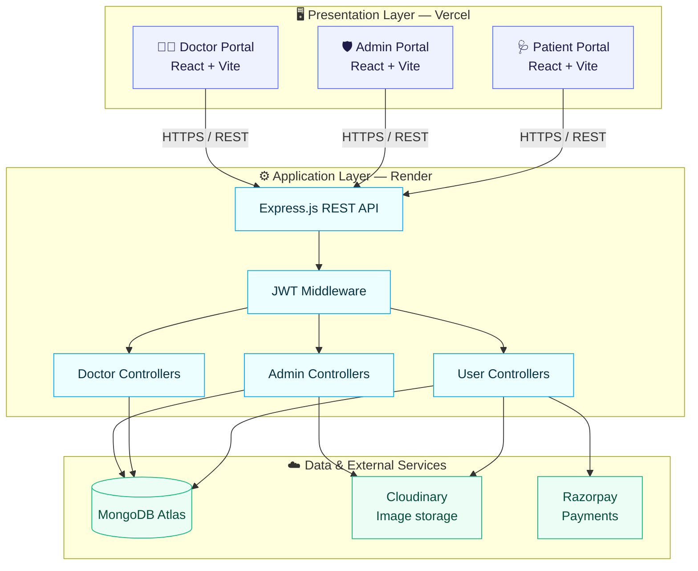
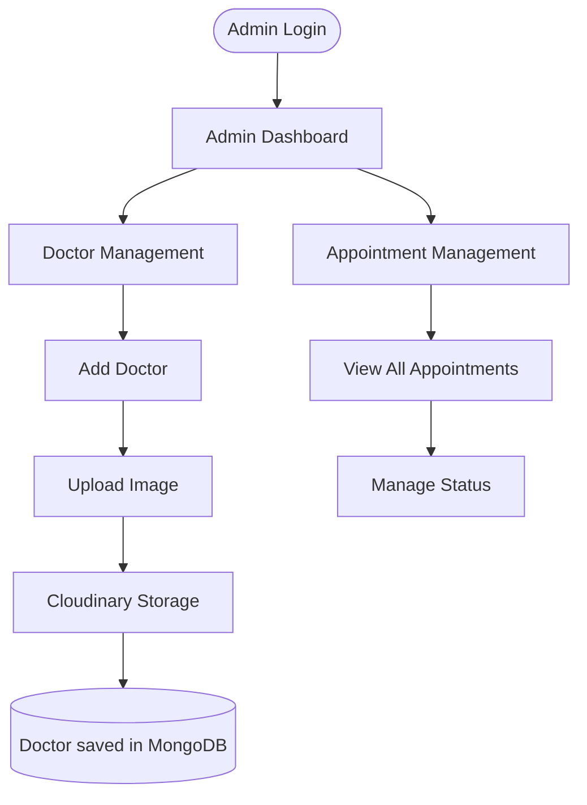
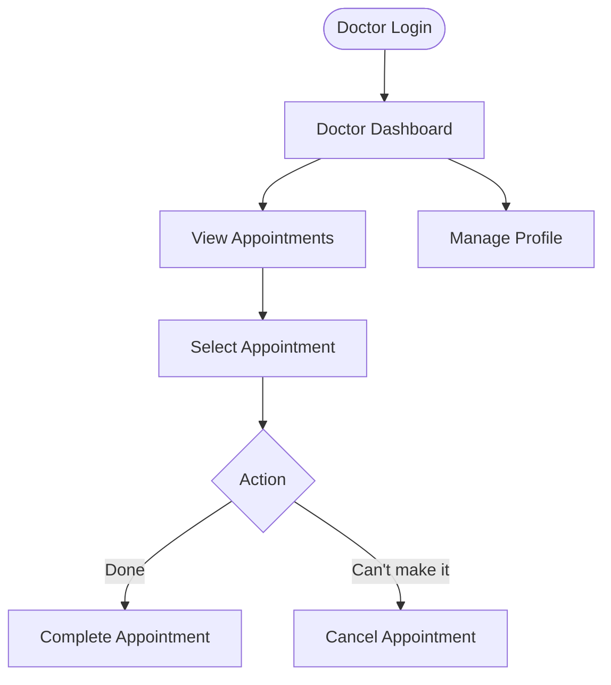
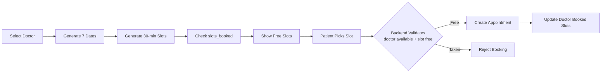
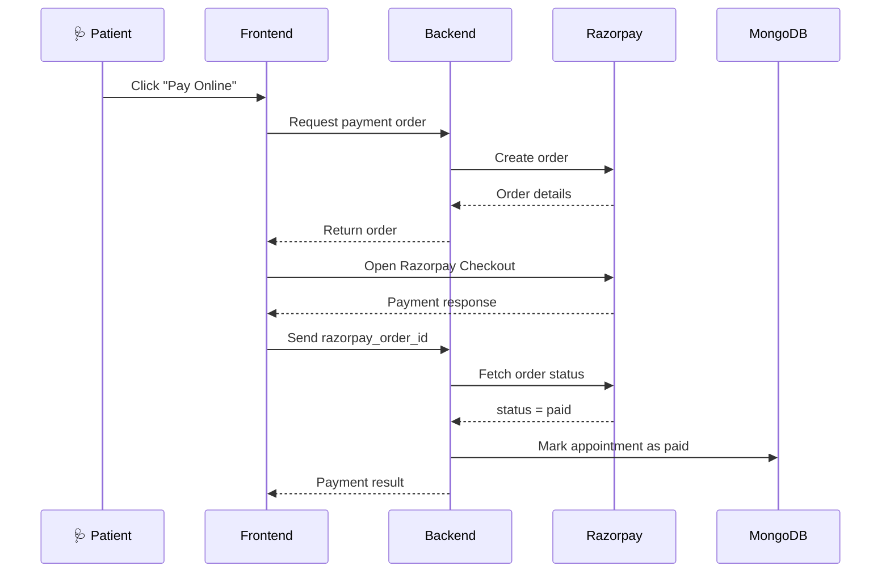
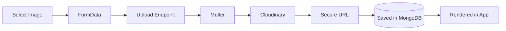
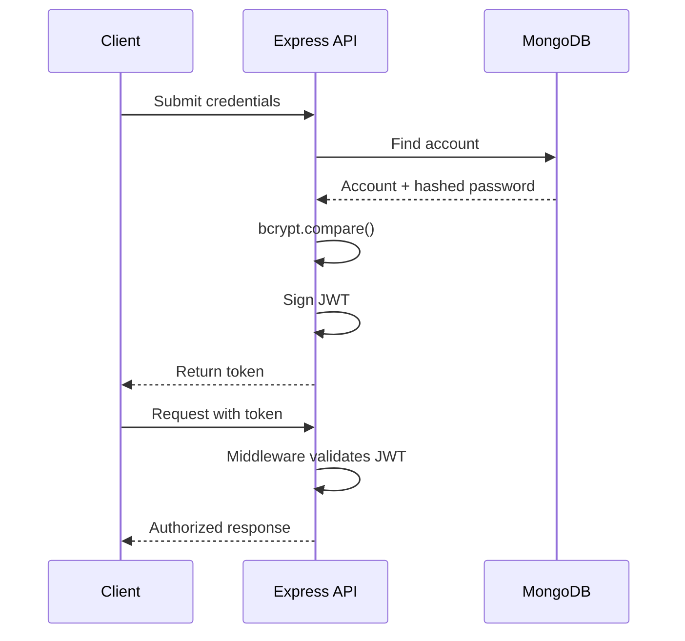
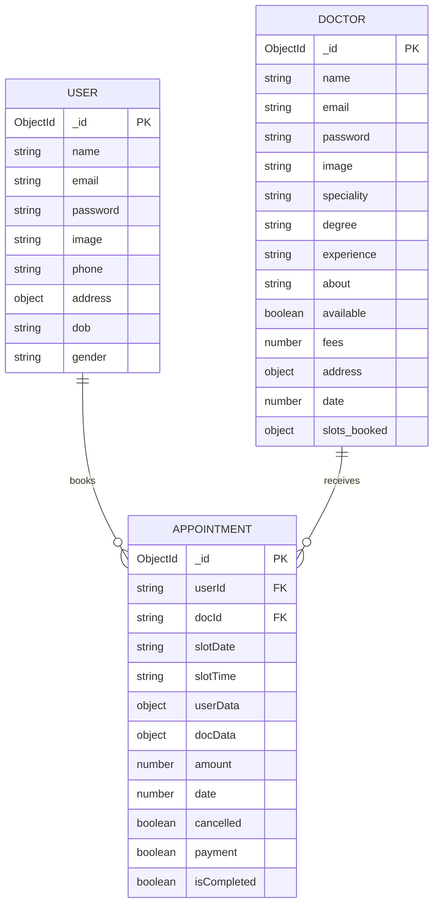
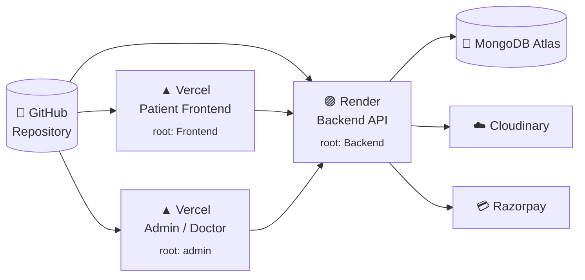

<div align="center">


<br/>

**One platform. Three portals. Zero booking chaos.**
A full-stack healthcare platform that connects **patients**, **doctors** and **administrators** through a single appointment-management ecosystem.

<br/>

<a href="https://YOUR-PATIENT-APP.vercel.app"></a>
<a href="https://prescripto-admin-navy.vercel.app"></a>
<a href="https://prescripto-backend-o7lj.onrender.com"></a>

<br/><br/>


<br/>


</div>

<br/>

<p align="center">
  <a href="#live-demo">Live Demo</a> •
  <a href="#features">Features</a> •
  <a href="#screenshots">Screenshots</a> •
  <a href="#architecture">Architecture</a> •
  <a href="#api">API</a> •
  <a href="#getting-started">Get Started</a> •
  <a href="#deployment">Deployment</a> •
  <a href="#roadmap">Roadmap</a>
</p>

---

<a id="live-demo"></a>
## 🚀 Live Demo

Everything below is deployed and running in production.

| | Application | What it does | Link |
|:-:|---|---|---|
| 🩺 | **Patient Portal** | Discover doctors, book slots, pay online, manage appointments | [**Open Patient Portal →**](https://prescripto-nu-three.vercel.app/) |
| 🛡️ | **Admin & Doctor Portal** | Admin: manage doctors & appointments. Doctor: run the day's schedule | [**Open Admin / Doctor Portal →**](https://prescripto-admin-navy.vercel.app) |
| ⚡ | **Backend REST API** | Centralised Express + MongoDB API serving all three experiences | [**Open API →**](https://prescripto-backend-o7lj.onrender.com) |
| 💻 | **Source Code** | Full monorepo | [**GitHub →**](https://github.com/aryankk073/Prescripto) |

**Live service status**

<p>
  
  
</p>

> [!NOTE]
> The backend root endpoint returns `API WORKING` when the service is up.
> If the backend runs on a free hosting tier, the **first request after a period of inactivity can take a short while** while the server wakes up. Subsequent requests are fast.

<details>
<summary><b>🔑 Demo access (click to expand)</b></summary>

<br/>

| Role | Where to log in | Credentials |
|---|---|---|
| Patient | Patient Portal → *Create account* | Register with any email — takes 10 seconds |
| Doctor | Admin / Doctor Portal → click **"Doctor Login?"** under the form | `<!-- add a demo doctor email -->` / `<!-- add password -->` |
| Admin | Admin / Doctor Portal → default login screen | `<!-- add demo admin email -->` / `<!-- add password -->` |

> Only share **demo** credentials here — never your real admin password.

</details>

---

<a id="features"></a>
## ✨ Features

<table>
<tr>
<td width="33%" valign="top">

### 🩺 Patients
- Browse doctors & filter by **speciality**
- Rich doctor profiles + related doctors
- Pick a date and **30-min time slot**
- Book, view & **cancel** appointments
- Pay securely with **Razorpay**
- Edit profile + upload profile photo

</td>
<td width="33%" valign="top">

### 👨‍⚕️ Doctors
- Dedicated, JWT-secured login
- Personal **dashboard** at a glance
- See all assigned appointments
- **Complete** or **cancel** appointments
- View & update own profile

</td>
<td width="33%" valign="top">

### 🛡️ Admins
- Secure administrator login
- Central **admin dashboard**
- **Add doctors** with image upload
- Browse the full doctor directory
- **Toggle doctor availability** on/off
- View & **cancel** any appointment

</td>
</tr>
</table>

### 🔥 Project highlights

| | |
|---|---|
| 🧑‍🤝‍🧑 **Three role-based experiences** | Patient, Doctor and Admin interfaces over one shared API |
| 🔐 **JWT auth + bcrypt** | Protected routes via middleware, hashed passwords |
| 📅 **Smart slot engine** | 7-day window, 30-minute slots, booked slots hidden automatically |
| 💳 **Razorpay payments** | Orders created server-side; payment confirmed by asking Razorpay directly |
| ☁️ **Cloudinary uploads** | Multer → Cloudinary → secure URL saved in MongoDB |
| 🌍 **Independent deployments** | Two Vercel frontends + Render backend + MongoDB Atlas |

---


<a id="architecture"></a>
## 🧩 Architecture

Prescripto is a **three-tier** system: independent React frontends talk over HTTPS to one Express REST API, which orchestrates MongoDB, Cloudinary and Razorpay.



| Layer | Technology | Responsibility |
|---|---|---|
| Patient Frontend | React, Vite, Tailwind CSS | Patient-facing experience |
| Admin / Doctor Frontend | React, Vite, Tailwind CSS | Administrative and doctor interfaces |
| Routing | React Router | Client-side navigation |
| State | React Context API | Shared application state |
| HTTP | Axios | API requests and responses |
| Backend | Node.js, Express.js | Business logic & REST endpoints |
| Database | MongoDB Atlas, Mongoose | Persistent application data |
| Auth | JWT, bcrypt | Authentication & password security |
| File Storage | Multer, Cloudinary | Image uploads and storage |
| Payments | Razorpay | Online payment processing |
| Hosting | Vercel, Render | Production deployment |

---

## 🔄 User Journeys

<details open>
<summary><b>🩺 Patient booking journey</b></summary>


</details>

<details>
<summary><b>🛡️ Admin workflow</b></summary>



</details>

<details>
<summary><b>👨‍⚕️ Doctor workflow</b></summary>



</details>

---

## 📅 Appointment Scheduling Engine

Scheduling is the heart of Prescripto. The patient app generates slots dynamically and hides anything already booked.

| Parameter | Value |
|---|---|
| 🗓️ Scheduling window | **7 days** |
| ⏱️ Slot duration | **30 minutes** |
| 🌅 Start time | **10:00 AM** |
| 🌙 End time | **9:00 PM** |
| 🚫 Availability | Computed from existing bookings (`slots_booked`) and the doctor's `available` flag |



> [!TIP]
> Availability is always validated on the backend. A natural production upgrade is **atomic booking operations** with database-level conflict prevention — see the [roadmap](#roadmap).

---

## 💳 Payments

Razorpay handles checkout, and **the backend confirms the result with Razorpay itself** — it fetches the order and only marks the appointment paid when the order status is `paid`. A client-side "success" is never trusted on its own.



## ☁️ File Uploads



Images live in Cloudinary — MongoDB only stores the lightweight URL.

---

## 🔐 Authentication & Security



| Component | Role |
|---|---|
| **JWT** | Token-based authentication for protected routes |
| **bcrypt** | Password hashing & verification |
| **Auth middleware** | Guards user, doctor and admin endpoints |
| **Environment variables** | Secrets stay out of source control |
| **CORS** | Enables the deployed frontends to call the backend |
| **Role separation** | Separate auth contexts for admin, doctor and patient |

---

## 🗃️ Database Design

MongoDB + Mongoose. Appointments link to patients and doctors by ID and also store a **snapshot** of both (`userData`, `docData`), so appointment lists render without extra lookups.



<details>
<summary><b>📋 Field reference</b></summary>

<br/>

**User** — `name`, `email` (unique), `password` (hashed), `image`, `phone`, `address`, `dob`, `gender` (sensible defaults for optional profile fields)

**Doctor** — `name`, `email`, `password` (hashed), `image`, `speciality`, `degree`, `experience`, `about`, `available`, `fees`, `address`, `date`, `slots_booked`

**Appointment** — `userId`, `docId`, `slotDate`, `slotTime`, `userData`, `docData`, `amount`, `date`, `cancelled`, `payment`, `isCompleted`

> Always treat the model files in [`Backend/models`](Backend/models) as the source of truth for exact field names.

</details>

---

<a id="api"></a>
## 🔌 API Reference

**Base URL**

```text
https://prescripto-backend-o7lj.onrender.com
```

| Route group | Base path | Responsibility |
|---|---|---|
| 🩺 User | `/api/user` | Registration, auth, profile, appointments |
| 👨‍⚕️ Doctor | `/api/doctor` | Doctor listing, auth, doctor operations |
| 🛡️ Admin | `/api/admin` | Admin auth & administrative operations |

<details>
<summary><b>🩺 User endpoints</b> <sub>(protected = JWT required)</sub></summary>

| Endpoint | Method | Auth | Purpose |
|---|:-:|:-:|---|
| `/api/user/register` | `POST` | — | Register patient |
| `/api/user/login` | `POST` | — | Patient login |
| `/api/user/get-profile` | `GET` | 🔒 | Retrieve patient profile |
| `/api/user/update-profile` | `POST` | 🔒 | Update profile (+ image upload) |
| `/api/user/book-appointment` | `POST` | 🔒 | Book an appointment |
| `/api/user/appointments` | `GET` | 🔒 | List the patient's appointments |
| `/api/user/cancel-appointment` | `POST` | 🔒 | Cancel an appointment |
| `/api/user/payment-razorpay` | `POST` | 🔒 | Create a Razorpay order |
| `/api/user/verifyRazorpay` | `POST` | 🔒 | Confirm payment & mark appointment paid |

</details>

<details>
<summary><b>👨‍⚕️ Doctor endpoints</b></summary>

| Endpoint | Method | Auth | Purpose |
|---|:-:|:-:|---|
| `/api/doctor/list` | `GET` | — | Public doctor listing |
| `/api/doctor/login` | `POST` | — | Doctor login |
| `/api/doctor/appointments` | `POST` | 🔒 | Doctor's appointments |
| `/api/doctor/complete-appointment` | `POST` | 🔒 | Mark appointment completed |
| `/api/doctor/cancel-appointment` | `POST` | 🔒 | Cancel appointment |
| `/api/doctor/dashboard` | `GET` | 🔒 | Dashboard data |
| `/api/doctor/profile` | `GET` | 🔒 | Retrieve doctor profile |
| `/api/doctor/update-profile` | `POST` | 🔒 | Update doctor profile |

</details>

<details>
<summary><b>🛡️ Admin endpoints</b></summary>

| Endpoint | Method | Auth | Purpose |
|---|:-:|:-:|---|
| `/api/admin/login` | `POST` | — | Admin login |
| `/api/admin/add-doctor` | `POST` | 🔒 | Add a doctor (+ image upload) |
| `/api/admin/all-doctors` | `POST` | 🔒 | List all doctors |
| `/api/admin/change-availability` | `POST` | 🔒 | Toggle a doctor's availability |
| `/api/admin/all-appointments` | `POST` | 🔒 | List all appointments |
| `/api/admin/cancel-appointment` | `POST` | 🔒 | Cancel any appointment |
| `/api/admin/dashboard` | `GET` | 🔒 | Dashboard data |

</details>

> [!NOTE]
> Source of truth: [`Backend/routes`](Backend/routes).

**Try it:**

```bash
# health check
curl https://prescripto-backend-o7lj.onrender.com
# → API WORKING

# list all doctors
curl https://prescripto-backend-o7lj.onrender.com/api/doctor/list
```

---

## 🛠️ Tech Stack

<div align="center">


</div>

<table>
<tr>
<td valign="top" width="33%">

**Frontend**
- React 19
- Vite
- React Router
- Tailwind CSS
- Axios
- Context API

</td>
<td valign="top" width="33%">

**Backend**
- Node.js & Express.js
- Mongoose & MongoDB Atlas
- JSON Web Tokens
- bcrypt
- Multer
- Validator, CORS, dotenv

</td>
<td valign="top" width="33%">

**Integrations & Ops**
- Cloudinary — image storage
- Razorpay — payments
- Vercel — frontend hosting
- Render — backend hosting
- Git & GitHub

</td>
</tr>
</table>

---

<details>
<summary><b>🧭 Frontend routes</b></summary>

<br/>

**Patient app** — `/` · `/doctors` · `/doctors/:speciality` · `/login` · `/about` · `/contact` · `/my-profile` · `/my-appointments` · `/appointment/:docId`

**Admin** — `/admin-dashboard` · `/all-appointments` · `/add-doctor` · `/doctor-list`

**Doctor** — `/doctor-dashboard` · `/doctor-appointments` · `/doctor-profile`

</details>

---

## 📁 Project Structure

```text
Prescripto/
│
├── Frontend/                    # 🩺 Patient application
│   ├── public/
│   └── src/
│       ├── assets/
│       ├── components/
│       ├── context/
│       ├── pages/
│       ├── App.jsx
│       └── main.jsx
│
├── admin/                       # 🛡️ Admin + 👨‍⚕️ Doctor application
│   ├── public/
│   └── src/
│       ├── assets/
│       ├── components/
│       ├── context/
│       ├── pages/
│       │   ├── Admin/
│       │   └── Doctor/
│       ├── App.jsx
│       └── main.jsx
│
├── Backend/                     # ⚡ Centralised REST API
│   ├── config/                  #    mongodb.js, cloudinary.js
│   ├── controllers/
│   ├── middleware/
│   ├── models/
│   ├── routes/
│   └── server.js
│
├── assets/                      # README banner
├── docs/screenshots/            # README screenshots
└── README.md
```

---

<a id="getting-started"></a>
## ⚡ Getting Started

### Prerequisites

Node.js · npm · Git · a MongoDB Atlas account · a Cloudinary account · a Razorpay account (test mode is fine)

### 1 · Clone

```bash
git clone https://github.com/aryankk073/Prescripto.git
cd Prescripto
```

### 2 · Backend

```bash
cd Backend
npm install
```

Create `Backend/.env`:

```env
PORT=4000
MONGODB_URI=your_mongodb_connection_string
JWT_SECRET=your_jwt_secret

ADMIN_EMAIL=your_admin_email
ADMIN_PASSWORD=your_admin_password

CLOUDINARY_NAME=your_cloudinary_name
CLOUDINARY_API_KEY=your_cloudinary_api_key
CLOUDINARY_SECRET_KEY=your_cloudinary_secret

RAZORPAY_KEY_ID=your_razorpay_key_id
RAZORPAY_KEY_SECRET=your_razorpay_key_secret
CURRENCY=INR
```

```bash
npm run server        # dev (nodemon) → http://localhost:4000
npm start             # production (what Render runs)
```

### 3 · Patient frontend

```bash
cd ../Frontend
npm install
cat > .env << 'EOF'
VITE_BACKEND_URL=http://localhost:4000
VITE_RAZORPAY_KEY_ID=your_razorpay_key_id
EOF
npm run dev
```

> Use only the **Key ID** (public) in the frontend — never the Key Secret.

### 4 · Admin / Doctor frontend

```bash
cd ../admin
npm install
echo "VITE_BACKEND_URL=http://localhost:4000" > .env
npm run dev
```

> [!IMPORTANT]
> Run the backend and both frontends in **separate terminals**, and make sure the env variable names match your actual app configuration. Never commit `.env` files.

---

<a id="deployment"></a>
## 🌍 Deployment

Three independent deployments, one shared database.



| Component | Platform | Root directory |
|---|---|---|
| Patient Frontend | Vercel | `Frontend` |
| Admin / Doctor App | Vercel | `admin` |
| Backend API | Render | `Backend` |
| Database | MongoDB Atlas | Managed |
| Image storage | Cloudinary | Managed |
| Payments | Razorpay | Managed |

<details>
<summary><b>🔧 Production environment variables</b></summary>

<br/>

**Backend (Render)** — set in the Render dashboard

`MONGODB_URI` · `JWT_SECRET` · `ADMIN_EMAIL` · `ADMIN_PASSWORD` · `CLOUDINARY_NAME` · `CLOUDINARY_API_KEY` · `CLOUDINARY_SECRET_KEY` · `RAZORPAY_KEY_ID` · `RAZORPAY_KEY_SECRET` · `CURRENCY`
*(Render supplies `PORT` automatically.)*

**Patient frontend (Vercel)**

```env
VITE_BACKEND_URL=https://prescripto-backend-o7lj.onrender.com
VITE_RAZORPAY_KEY_ID=your_razorpay_key_id
```

**Admin / Doctor frontend (Vercel)**

```env
VITE_BACKEND_URL=https://prescripto-backend-o7lj.onrender.com
```

</details>

---

## 🧠 Engineering Decisions

| Decision | Why it matters |
|---|---|
| **Separation of concerns** | Routes, controllers, middleware, models and config are split — easier to test, read and extend |
| **Independent frontends** | Patient and admin/doctor apps deploy separately with role-specific routing & context |
| **Centralised API** | Business rules live server-side once, not duplicated across three UIs |
| **Secrets stay on the server** | Cloudinary & Razorpay are integrated through the backend, not the browser |
| **Snapshot + reference** | Appointments store patient/doctor IDs plus a data snapshot, keeping list views fast |

---

<a id="roadmap"></a>
## 🗺️ Roadmap

- [ ] 📧 Email & SMS appointment notifications
- [ ] ⏰ Automated appointment reminders
- [ ] 🗓️ Doctor availability calendar with recurring schedules
- [ ] 🔴 Real-time appointment status updates
- [ ] 🔒 Stronger concurrency control for simultaneous slot booking
- [ ] 🔁 Razorpay signature verification & webhook-based payment reconciliation
- [ ] 🌐 Restrict CORS to the known frontend origins
- [ ] 💸 Refund processing & payment history
- [ ] 🔎 Advanced doctor search & filtering
- [ ] 📊 Patient history & doctor performance analytics
- [ ] 🧪 Automated tests (Jest / Vitest) + API integration tests
- [ ] 📚 Swagger / OpenAPI documentation
- [ ] 🪵 Centralised logging & monitoring
- [ ] 🚦 Rate limiting & hardened API security
- [ ] 🐳 Docker-based dev & deployment
- [ ] ⚙️ CI/CD with GitHub Actions

---

## 🎓 What I Learned

- Structuring a multi-application full-stack repository
- Building RESTful APIs with Express.js
- Designing MongoDB schemas and document relationships
- JWT authentication and protected routes
- Shared React state with the Context API
- Implementing appointment scheduling & booking workflows
- Integrating third-party payments (Razorpay)
- Handling image uploads with Multer + Cloudinary
- Debugging frontend ↔ backend integration (CORS, env, deployment)
- Managing environment variables across local and production
- Deploying separate frontends and a central backend

---

## 👤 Author

<table>
<tr>
<td>

**Aryan Kumar**

[](https://github.com/aryankk073)


</td>
</tr>
</table>

---

<div align="center">

### ⭐ If you like Prescripto, give it a star — it really helps!

**Prescripto — Bringing Patients, Doctors, and Healthcare Management Together.**


</div>